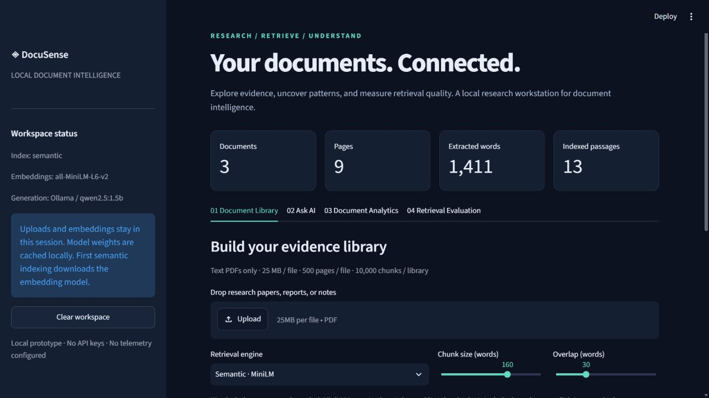
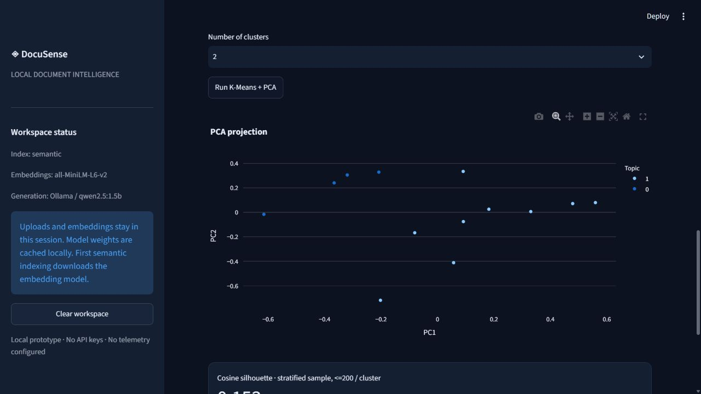

# ◈ DocuSense

**Local document intelligence, with evidence you can inspect and retrieval you can measure.**

DocuSense turns text PDFs into a searchable research library. It combines pretrained semantic retrieval, an explicit TF-IDF baseline, local RAG, exploratory ML, and reproducible retrieval experiments in a Streamlit workstation. No API keys or paid services are required. First-time package and model downloads need internet access.

This is a single-user **local prototype**, developed with AI coding assistance. It integrates pretrained models rather than training a foundation model. Evaluation results apply to the named demo corpus, not to arbitrary documents.

## Why this project

A PDF chatbot alone says little about retrieval quality. DocuSense makes provenance, baseline comparison, data quality, and failure behavior visible. It demonstrates data science through annotation, exploratory analysis and experiments; ML engineering through reproducible inference and modular tests; and AI engineering through evidence-grounded prompting and local generation.

## Capabilities

| Area | Implementation |
| --- | --- |
| Ingestion | Multiple PDFs, content-hash deduplication, page metadata, stable chunk IDs, scanned/corrupt PDF errors |
| Retrieval | CPU MiniLM embeddings + normalized NumPy cosine ranking; labeled sparse TF-IDF baseline |
| RAG | Local Ollama Qwen, source-labeled evidence, invalid-citation withholding, explicit unavailable-model states |
| Data science | Accurate corpus statistics, term frequencies, Plotly distributions, K-Means, PCA, valid silhouette |
| Evaluation | Reviewed page/chunk labels, Recall@1/3/5, MRR@5, latency, query CSVs, chunk-size ablations |
| Engineering | Typed modules, deterministic tests, Streamlit integration test, GitHub Actions, VS Code tasks/debugging |

## Architecture

```mermaid
flowchart LR
    PDF[Text PDFs] --> Parse[PyMuPDF extraction]
    Parse --> Chunk[Page-bounded windows + source IDs]
    Chunk --> Dense[MiniLM encoder]
    Chunk --> Lexical[TF-IDF baseline]
    Dense --> Index[Normalized NumPy index]
    Q[Question] --> Search[Top-k retrieval]
    Index --> Search
    Lexical --> Search
    Search --> Evidence[Passages + provenance]
    Evidence --> Ollama[Local Ollama / Qwen]
    Ollama --> Validate[Citation ID validation]
    Validate --> UI[Streamlit workstation]
    Evidence --> UI
    Dense --> Analytics[K-Means / PCA / silhouette]
    Search --> Eval[Recall@K / MRR@5 / latency]
    Labels[Reviewed labels] --> Eval
```

The core modules do not depend on Streamlit. Uploaded documents, extracted text, embeddings, and history remain in session memory; the app does not automatically save them. Model weights are cached under ignored `.cache/huggingface/`. Exports intentionally contain question/source text.

## Windows setup

Install Python 3.12 or 3.13 and [VS Code](https://code.visualstudio.com/). Open this folder in VS Code and install the recommended Python extensions. The workspace interpreter points to `.venv/Scripts/python.exe`; press F5 to debug the app or use **Terminal > Run Task**.

```powershell
py -3.12 -m venv .venv
.\.venv\Scripts\python.exe -m pip install -r requirements.txt
.\.venv\Scripts\python.exe -m streamlit run app.py
```

Or run `powershell -ExecutionPolicy Bypass -File scripts/setup.ps1`, then `scripts/run.ps1`. ExecutionPolicy Bypass applies only to that command's process. The project built in this workspace already has a local virtual environment; activation is optional when using the explicit interpreter path.

With an activated virtual environment, the standard run command is:

```text
python -m streamlit run app.py
```

The app binds to `127.0.0.1:8501`. Keyword search works without model downloads. Select **Keyword · TF-IDF baseline** in Document Library, then **Load reproducible demo**. Select **Semantic · MiniLM** and rebuild for embeddings and clustering. A failed embedding setup falls back with a visible keyword-search notice.

## WSL / Linux setup

```bash
python3.12 -m venv .venv
source .venv/bin/activate
python -m pip install -r requirements.txt
python -m streamlit run app.py
```

Create a separate environment inside WSL; Windows virtual environments are not portable. The committed VS Code interpreter path targets Windows; select the WSL interpreter when using the Remote - WSL extension.

## Local language model

Install [Ollama from its official site](https://ollama.com/download/windows), then:

```text
ollama pull qwen2.5:1.5b
ollama serve
```

The Windows app may already run the server, in which case a second `serve` command is unnecessary. On WSL, install/run Ollama inside WSL for this loopback configuration. DocuSense calls `http://127.0.0.1:11434/api/generate`. Local inference speed and memory use depend on hardware. If unavailable, the app displays evidence and a setup message without inventing an answer.

## Reproduce tests and experiments

```powershell
.\.venv\Scripts\python.exe -m pytest -q
.\.venv\Scripts\python.exe scripts/doctor.py
.\.venv\Scripts\python.exe scripts/benchmark.py
.\.venv\Scripts\python.exe scripts/benchmark.py --semantic
```

The first benchmark uses TF-IDF only. `--semantic` compares TF-IDF with MiniLM on the same labels at chunk sizes/overlaps 80/15, 160/30, and 220/40. Outputs are real observations in `reports/ablation.csv`, query CSVs, and `reports/environment.json`. Index timing can benefit from the in-memory passage cache; this is not a cold-start speed comparison. Query encoding runs on every search, including repeated questions. See [verification report](docs/verification.md) for what was actually run on the build machine.

Run `python scripts/analyze_results.py` for an interactive ablation chart and paired-bootstrap MRR difference intervals. Open `notebooks/retrieval_analysis.ipynb` in VS Code to explore results and failure queries. Optional notebook dependencies: `python -m pip install -r requirements-dev.txt`. The committed `requirements-lock.txt` captures the tested core environment; `requirements.txt` specifies compatible ranges for fresh installs.

To reconstruct original demo assets or guides:

```text
python scripts/build_demo.py
python scripts/build_guides.py
```

Demo PDFs use invariant metadata for stable byte hashes under the same ReportLab version. If regenerated bytes differ, rebuild labels together. The included original educational corpus contains 3 PDFs, 9 pages, and 18 reviewed development questions. [Annotation review](examples/demo/annotation_review.md) links each question to its answer-bearing page. It is not an independent benchmark.

## Evaluation methodology

Recall@K is `distinct annotated relevant IDs in the first K results / all annotated relevant IDs`. Page-level labels are stable across chunking configurations for the same PDF bytes. Multiple chunks from a page occupy ranks but count once in the relevant-page numerator. MRR@5 averages the reciprocal rank of the first relevant result within depth five; misses score zero. Metrics are macro averaged across questions.

The UI supports annotation against inspected pages and JSON import/export. Source manifests expose stable IDs for chunk-level labels. Every imported label is validated against the active corpus; stale IDs are rejected.

```json
[
  {"question": "Your question", "unit": "page", "relevant_ids": ["<document-sha256>:p2"]}
]
```

The example above is a format template, not a usable label. Replace the ID with a verified ID from the source manifest. For chunk labels, set `unit` to `chunk` and use chunk IDs. Retrieval relevance is separate from answer factuality. Citation validation verifies membership in retrieved evidence, not whether a passage supports each claim.

## RAG and cosine similarity

MiniLM encodes a passage/question as a vector. Normalizing vectors makes the dot product equal cosine similarity: `cos(q,d) = q·d / (||q|| ||d||)`. Scores are representation similarities, not relevance probabilities. The TF-IDF baseline also uses normalized sparse vectors, but its scores are not calibrated against dense scores.

RAG retrieves top-k passages and supplies them as untrusted evidence to a local generator. Responses cite `[S1]`, `[S2]`, and so on. DocuSense withholds unknown references and uncited assertions, permits explicit abstention, and exposes evidence. These checks cannot eliminate hallucination or prompt injection.

## Research paper examples

The repository includes original demo content. To optionally download public research papers into ignored `data/`:

```text
python scripts/download_papers.py
```

Suggested sources: [Attention Is All You Need](https://arxiv.org/abs/1706.03762), [BERT](https://arxiv.org/abs/1810.04805), and [Retrieval-Augmented Generation](https://arxiv.org/abs/2005.11401). Manual upload works if downloads fail. Demo labels do not apply to these papers; annotate their pages before evaluation. The repository does not redistribute these third-party PDFs.

## Project map

```text
app.py                    Four-tab Streamlit workstation
src/pdf_parser.py         In-memory PDF extraction and validation
src/chunking.py           Page-bounded overlapping word windows
src/embeddings.py         MiniLM and bounded in-memory cache
src/retrieval.py          Dense cosine and sparse TF-IDF retrieval
src/rag.py                Ollama, evidence prompts, citation checks
src/analytics.py          Descriptive stats, K-Means, PCA, silhouette
src/evaluation.py         Validated labels and ranking metrics
scripts/                  Setup, doctor, demo, benchmark, guide generation
examples/demo/            Original PDFs and reviewed labels
tests/                    Unit and Streamlit integration tests
reports/                  Measured experiment artifacts
docs/                     Maintained explanations and verification notes
output/pdf/               Technical guide and interview guide
.vscode/                  Interpreter, tests, debugger, tasks
```

## Screenshots and documentation





Screenshots show the actual running application. See the [technical guide](docs/technical_guide.md) for design details and the [interview guide](docs/interview_guide.md) for a demo walkthrough, explanations, and defensible resume language. PDF editions are in `output/pdf/`. [Verification and measured results](docs/verification.md) include actual local inference limitations.

## Limitations and next steps

- English text extraction and keyword assumptions; no OCR or scanned-document indexing.
- MiniLM truncates beyond its subword-token budget. Configurable word windows are an approximation.
- Brute-force dense retrieval and in-memory state suit small libraries; no persistent user index or authentication.
- Small, development-only labels; no held-out generation factuality score or calibrated abstention model.
- The small generator may overcite retrieved sources; validated IDs do not imply each cited passage supports the claim.
- K-Means/PCA are exploratory, and silhouette is a bounded sample estimate for larger clusters.
- No guarantee against malicious PDFs, prompt injection, unsupported answers, or high-stakes errors.

Next steps: independently annotated held-out corpus, query error analysis, tokenizer-aware chunking, hybrid retrieval/reranking, OCR quality checks, versioned ANN indexes, and production access controls. Add complexity only when measurements justify it.

## Resume summary

Built a local PDF intelligence prototype using Python, Streamlit, Sentence Transformers, NumPy, and Ollama, with source-traceable RAG, exploratory embedding clustering, and reproducible retrieval evaluation against a TF-IDF baseline. Implemented Recall@K/MRR@5, query-level exports, automated tests, and CI.

Use numerical claims only after reproducing the named experiment. Be ready to explain the implementation and acknowledge AI coding assistance. [Interview guide](docs/interview_guide.md).

## References

[Sentence Transformers](https://sbert.net/docs/sentence_transformer/usage/semantic_textual_similarity.html) · [MiniLM model card](https://huggingface.co/sentence-transformers/all-MiniLM-L6-v2) · [Ollama generation API](https://docs.ollama.com/api/generate) · [PyMuPDF](https://pymupdf.readthedocs.io/)

MIT license covers this project's original code and authored demo content. Third-party dependencies and model weights retain their own licenses.
